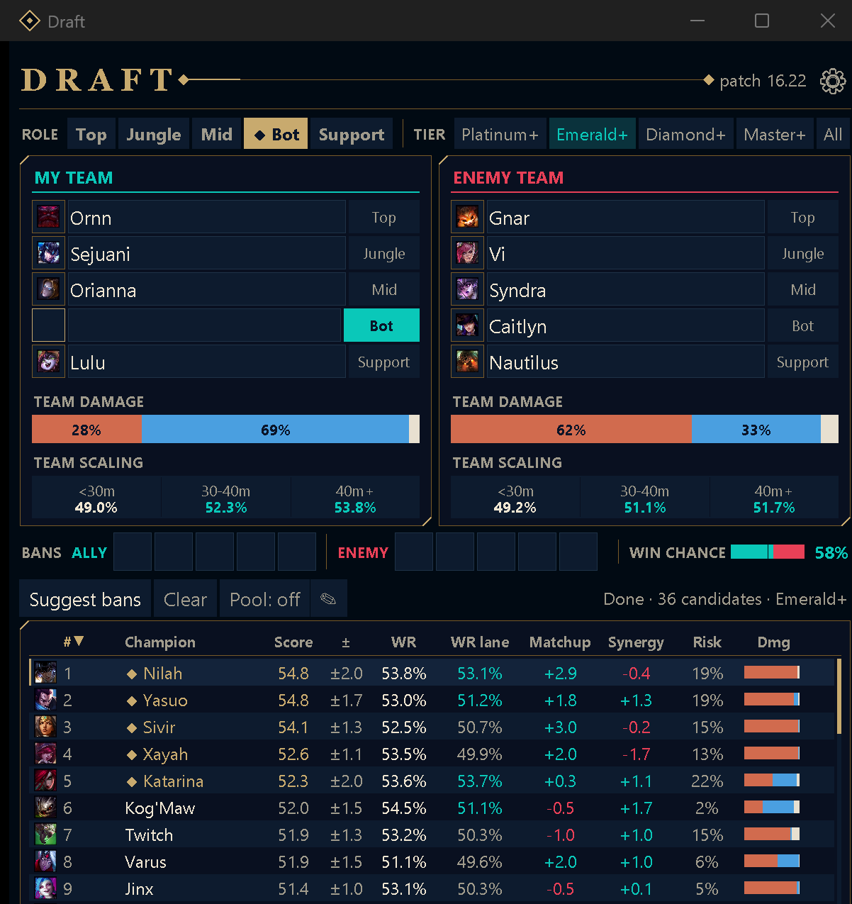
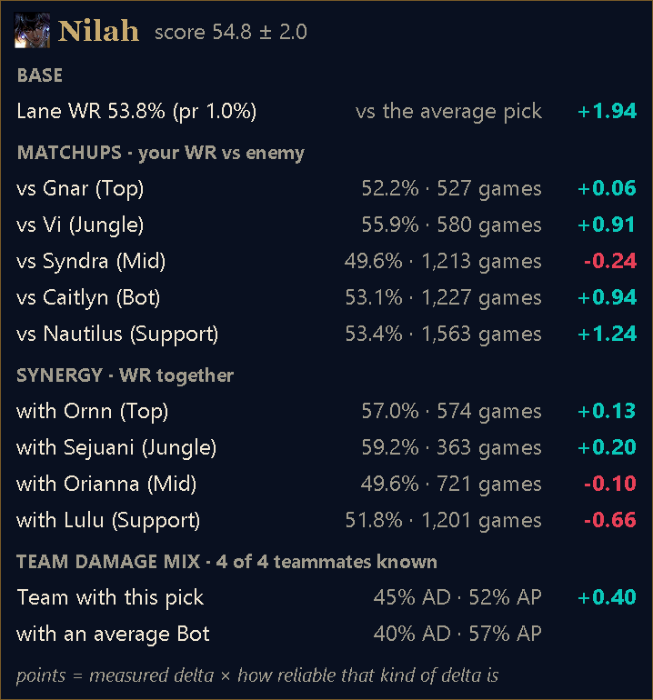
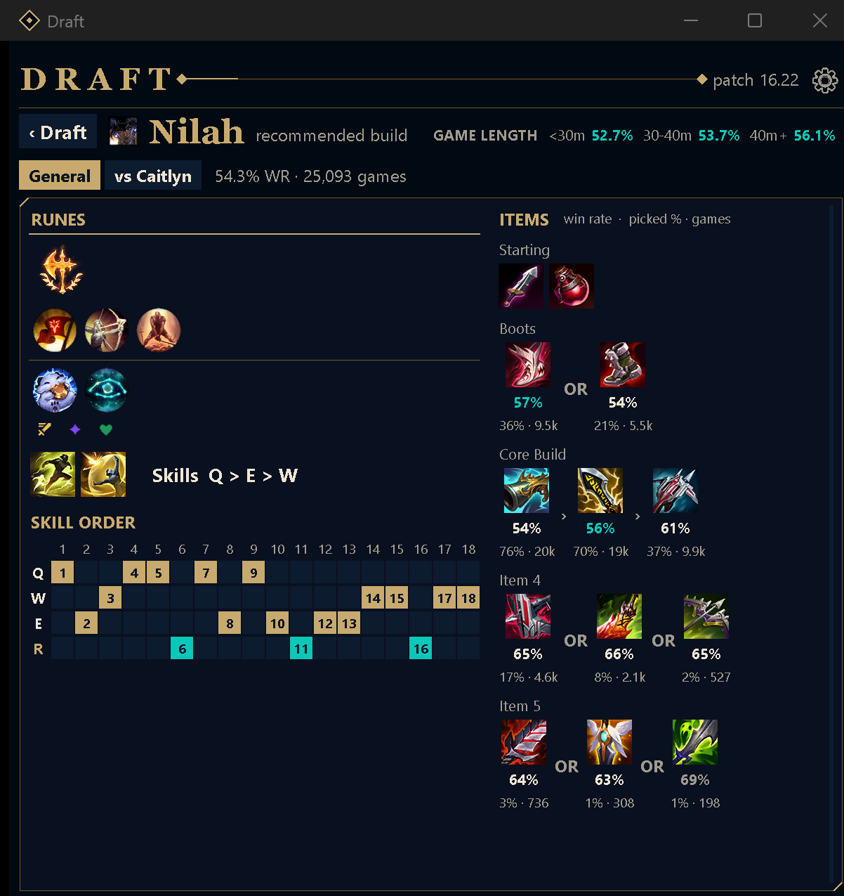
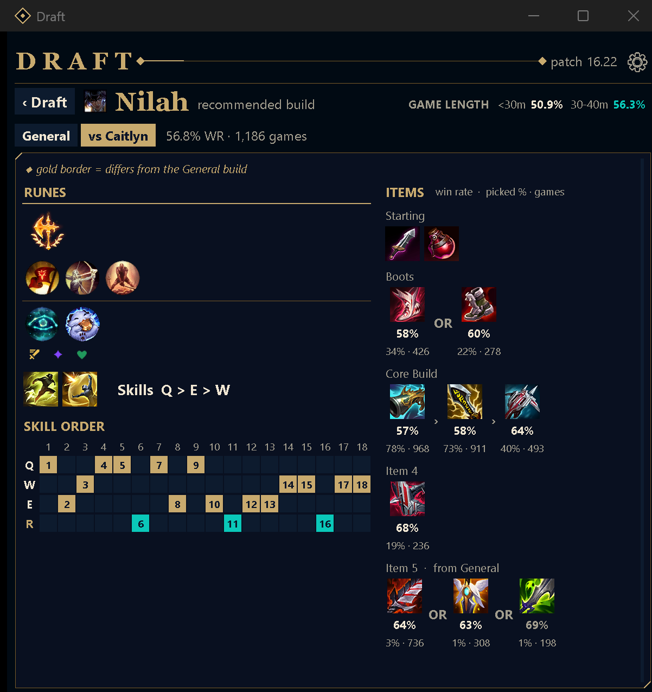

# D R A F T

**Pick the right champion in champ select.**

**[⬇ Download for Windows](../../releases/latest)** · free · no install

Draft sits next to League of Legends. When you enter champ select it reads the draft by itself and ranks the best champions for your role. Every number comes from real games. *(Click any picture to enlarge.)*

<table>
<tr>
<td width="50%" valign="top"><b>Why this pick</b> Click any number to see where it comes from.  </td>
<td width="50%" valign="top"><b>Win chance</b> Your team's chance to win, from the whole draft.  </td>
</tr>
<tr>
<td width="50%" valign="top"><b>Dodge advice</b> Tells you when dodging beats playing.  </td>
<td width="50%" valign="top"><b>Ban suggestions</b> The champions that hurt most in your role.  </td>
</tr>
<tr>
<td width="50%" valign="top"><b>Runes and builds</b> Colours show up only when a difference is real.  </td>
<td width="50%" valign="top"><b>Builds against your opponent</b> The build changes with your lane matchup.  </td>
</tr>
<tr>
<td width="50%" valign="top"><b>Your champion pool</b> Only see the champions you play.  </td>
<td width="50%" valign="top"><b>Settings</b> Optional: count how much you played each champion this season.  </td>
</tr>
</table>

## Install

1. Download `Draft-v2.2-windows.zip` from the [latest release](../../releases/latest) and unzip it.
2. Run `Draft.exe`. If Windows says *"protected your PC"*, click **More info → Run anyway** (the file isn't code-signed).
3. Start League. Draft connects by itself in champ select.

## Does it work?

Tested on 28,072 real ranked games, then again on 3,680 it had never seen: **+1 Score ≈ +1 % win rate**, and the winner is predicted in **56 %** of games. Expect roughly **1–3 % more wins**, not magic.

## Good to know

Statistics come from [lolalytics](https://lolalytics.com), so Draft may need an update if they change their site. Draft runs on your computer and sends nothing to anyone.

Draft isn't endorsed by Riot Games and doesn't reflect the views or opinions of Riot Games or anyone officially involved in producing or managing Riot Games properties. Riot Games and all associated properties are trademarks or registered trademarks of Riot Games, Inc.
