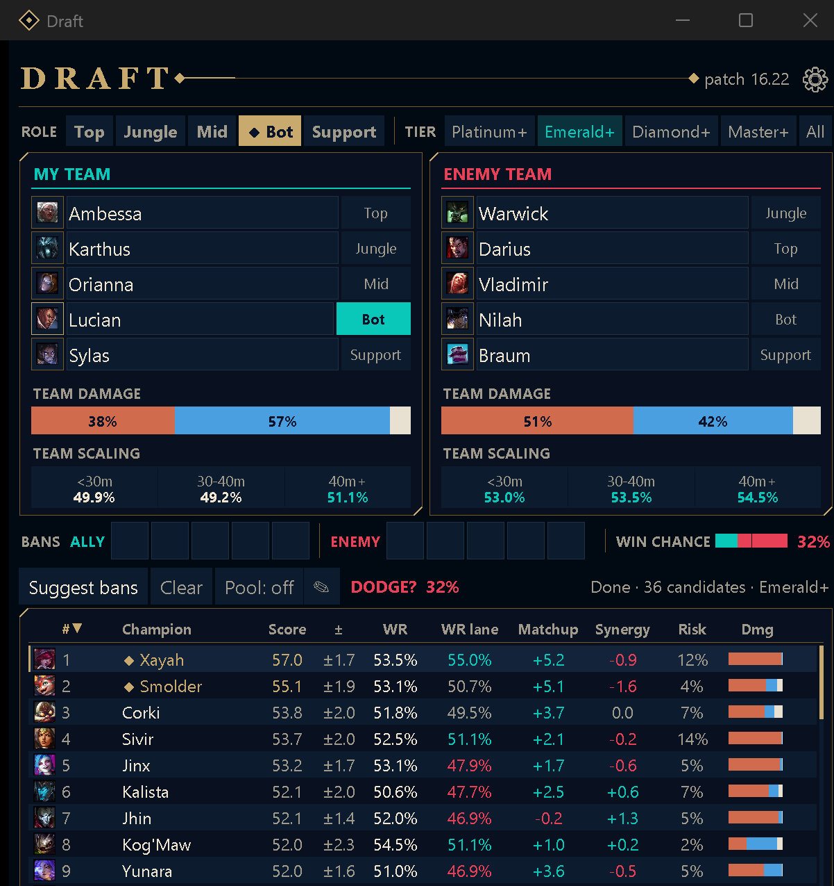
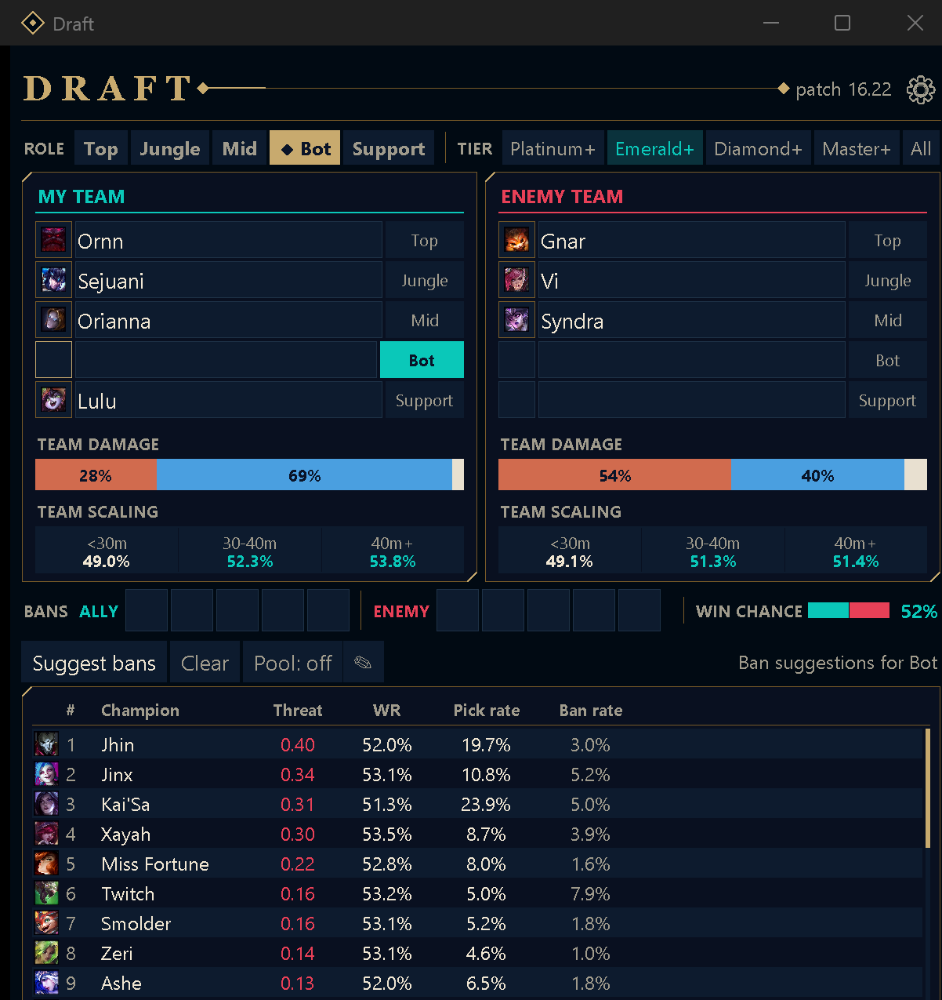
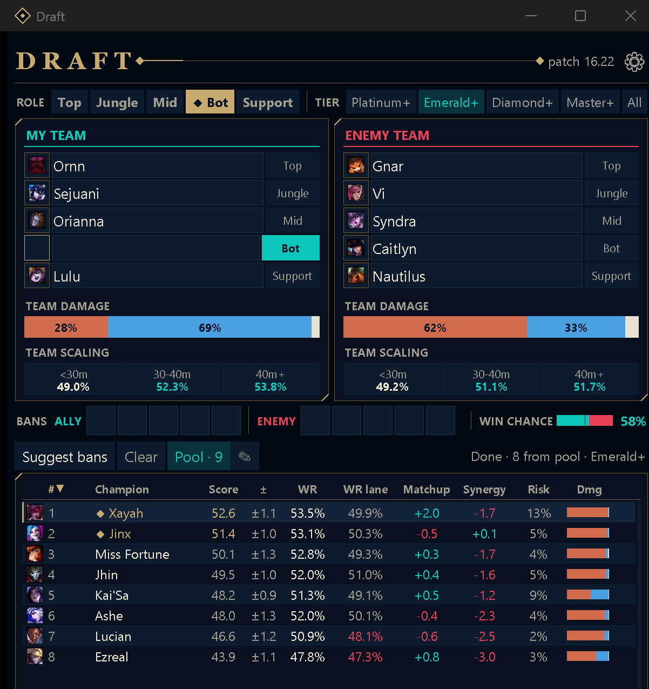
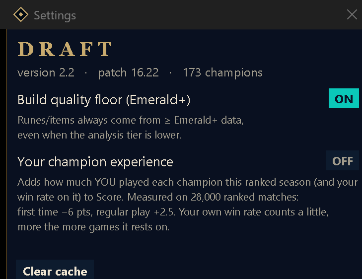

# D R A F T

### Pick the right champion in champ select.

**[⬇ Download for Windows](../../releases/latest)**

Free · no install · Windows 10/11

 

 

## What is it?

Draft sits next to League of Legends. When you enter champ select it reads the draft by itself and tells you which champions to pick.

Every number comes from real games. Nothing is guessed.

 

## Best picks, ranked

Every champion gets a **Score**: your expected win rate with that pick, given who is already picked and banned. **50 is an average pick.** The list updates by itself as the draft changes.

 

## Click any number to see why

&nbsp;&nbsp;

**Left:** where a pick's Score comes from. **Right:** your team's chance to win, from everything picked so far.

 

## Win chance for the whole draft

The bar next to the bans shows how your team is doing. It looks at champion strength, matchups, synergies, damage mix, and which side you are on. Click it for the full breakdown.

 

## Dodge advice

If the draft is bad enough that dodging beats playing it, Draft tells you.

 

## Runes and builds

Click a champion to see the best runes, items and skill order. Colours only show up when a difference is real, so a lucky 63 % on 38 games does not look like a sure thing.

 

## Builds against your lane opponent

Switch to a matchup and the build changes to what works against that champion.

 

## Ban suggestions

Not sure what to ban? One click shows the champions that hurt most in your role.

 

## Your own champion pool

Add the champions you actually play, and the list only shows those.

 

## Settings

*Your champion experience* is off by default. Turn it on to count how much you played each champion this ranked season.

 

## Install

1. Download `Draft-v2.2-windows.zip` from the [latest release](../../releases/latest) and unzip it.
2. Run `Draft.exe`.
3. Windows may say *"Windows protected your PC"*. Click **More info → Run anyway**. (The file is not code-signed.)

Start League. Draft connects by itself when you enter champ select.

 

## Does it work?

It was tested on 28,072 real ranked games, and checked again on 3,680 games it had never seen.

- **+1 Score is about +1 % win rate.**
- It predicts the winner of **56 %** of games.
- Teams with a big predicted edge won **59.7 %**.

Following Draft is worth roughly **1–3 % more wins**. It will not win games for you, but it picks the right champion more often than guessing.

 

## Good to know

- Statistics come from [lolalytics](https://lolalytics.com). If they change their site, Draft may need an update.
- Draft runs on your computer. It sends nothing to anyone.
- Weights were measured on Emerald and above. Other ranks work, but with less proof.

 

Draft isn't endorsed by Riot Games and doesn't reflect the views or opinions of Riot Games or anyone officially involved in producing or managing Riot Games properties. Riot Games and all associated properties are trademarks or registered trademarks of Riot Games, Inc.
