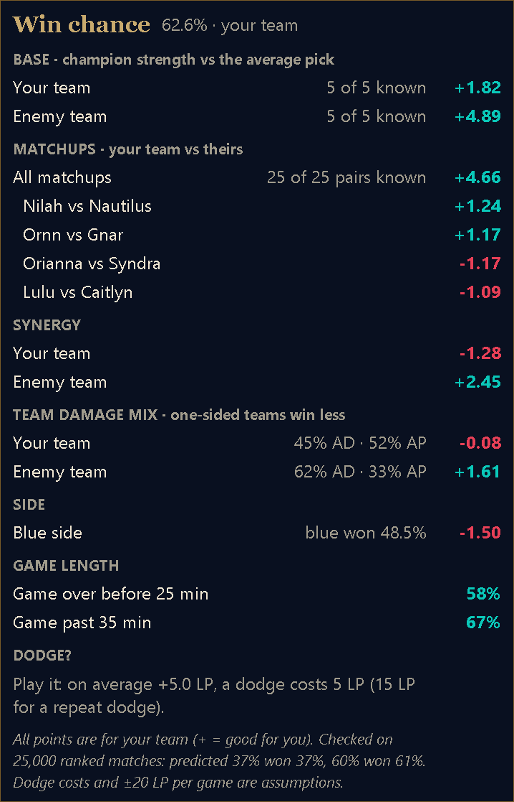

# D R A F T

**Champion select assistant for League of Legends — built on measured win rates, checked against 28,000 real ranked games.**

[**Download for Windows**](../../releases/latest) · Windows 10/11 · no install · free

---

## What it does

Open Draft next to the League client. It reads champ select by itself and ranks the best picks for your role, using the champions that are already picked and banned. Every number in it is a measured win rate — click any number to see exactly where it comes from.

- **Pick suggestions** ranked by *Score* — your expected win rate for each champion given the full draft. 50 means the average pick in your role.
- **Win chance** for your whole team from what is picked so far: base strength, matchups, synergies, team damage mix, side, and how the game plays out if it ends early or runs long.
- **Dodge advice** when a draft is bad enough that dodging beats playing it.
- **Team damage mix** — all-AD or all-AP teams win less. Draft counts that for you.
- **Your experience** (optional, off by default): how much you actually played each champion this ranked season, with your own win rate on it.
- **Runes and builds** for every pick, with pick rates and honest colouring — a win rate is only green or red when it is clearly different from the slot's average, not when it rests on 38 games. One click sends the runes to your client.
- **Your pool:** filter the list down to champions you play.

 &nbsp; 

## How good is it?

Honest numbers. The model was tested the hard way: statistics from the *previous* patch (16.21) predicting real ranked matches on the *next* one (16.22) — 28,072 Emerald–Master games on EUW. The weights were then chosen on most of them and checked on **3,680 games collected afterwards** that played no part in choosing them:

| On the 3,680 unseen games | Result |
|---|---|
| +1 Score | ≈ **+1.0 pp** win rate (1.02 ± 0.10) |
| Predicts the winner | **56 %** of matches |
| Team with a ≥ 5 pp predicted edge | won **59.7 %** |

And on the 25,000 games the weights were tuned on: a predicted win chance of 37 % actually won 37 %, and 60 % won 61 %.

**What that means for you:** a draft decides a small part of a game. Following Draft is worth roughly **1–3 percentage points** of win rate — a few extra wins per hundred games, not a different game. It does not replace knowing your champion.

## Install

1. Download `Draft-v2.2-windows.zip` from the [latest release](../../releases/latest) and unzip it.
2. Run `Draft.exe`.
3. Windows may say *"Windows protected your PC"* because the file is not code-signed. Click **More info → Run anyway**.
4. Start League. Draft connects by itself when you enter champ select — there is nothing to log in to.

Check the download if you like: the SHA-256 of `Draft.exe` is in the release notes.

## Settings (⚙)

- **Build quality floor** — runes/items always come from Emerald+ data.
- **Your champion experience** — adds how often you played each champion this ranked season. With a [Riot API key](https://developer.riotgames.com) in the environment variable `DRAFT_RIOT_API_KEY` it reads your whole ranked season; without one it uses your last 20 games. Off by default.
- **Clear cache** — forces fresh data after a new patch.

## Privacy

Draft runs locally. It talks to the League client on your own computer, to lolalytics for statistics, and to Riot's Data Dragon for icons. With *Your champion experience* on and an API key set, it also asks Riot for your ranked games. Settings and caches live in your home folder (`.draft_tool.json`, `.draft_cache.json`, `.draft_season.json`). Nothing is sent to me.

## Good to know

- Statistics come from [lolalytics](https://lolalytics.com). If they change their site, Draft can stop loading data until it is updated.
- Weights were calibrated on Emerald and above; they are used for every tier.
- Opponents' roles are guessed until they show — change a role by clicking its chip.
- The dodge advice assumes 5 LP for a dodge and ±20 LP per game. Those two numbers are assumptions, not measurements.

## Disclaimer

Draft isn't endorsed by Riot Games and doesn't reflect the views or opinions of Riot Games or anyone officially involved in producing or managing Riot Games properties. Riot Games and all associated properties are trademarks or registered trademarks of Riot Games, Inc.
